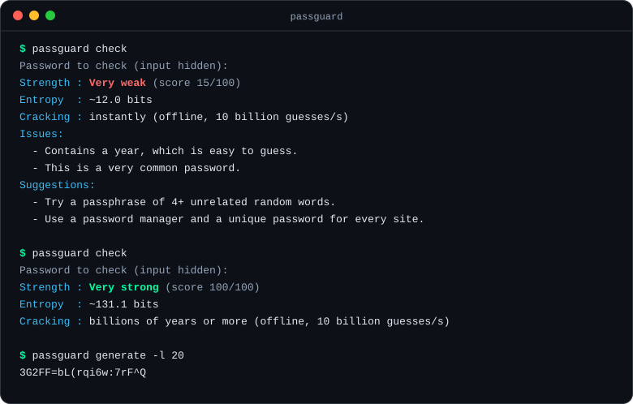

<p align="center">
  
</p>

<p align="center">
  <a href="#quick-start">Quick start</a> &nbsp;·&nbsp;
  <a href="#usage">Usage</a> &nbsp;·&nbsp;
  <a href="#breach-check-optional">Breach check</a> &nbsp;·&nbsp;
  <a href="#how-scoring-works">How it works</a> &nbsp;·&nbsp;
  <a href="#limitations">Limitations</a>
</p>

<p align="center">
  <a href="https://github.com/lasmeldas/passguard/actions/workflows/ci.yml"></a>
  
  
  
</p>

<p align="center"><b>Find out how long a password would really last, and why, without sending it anywhere.</b></p>

<p align="center">
  
</p>

`passguard` is a small command-line tool and Python library. It estimates how hard a password is to guess offline, explains what's wrong with it, and can generate strong replacements. Everything runs on your machine; the only network call is an optional breach lookup that never sends your password.

## Features

- **Entropy estimate** from length and character variety, reduced for the patterns attackers try first.
- **Pattern detection:** runs of repeated characters, keyboard and alphabet sequences (`qwerty`, `abc`, `987`), years, common passwords, and leetspeak tricks like `p@ssw0rd`.
- **Clear output:** a rating, a 0-100 score, an estimated offline cracking time, and concrete suggestions.
- **Optional breach check** against Have I Been Pwned using k-anonymity, so only 5 characters of a hash are ever sent.
- **Script-friendly:** `--json` output and `--min-score` exit codes for CI and shell scripts.
- **Safe input:** the password is read with hidden input or stdin, never from command-line arguments, and never appears in the result.
- **Generator** built on Python's `secrets` module.
- **No dependencies.** Tested on Python 3.9, 3.11 and 3.13 in CI.

## Quick start

```bash
git clone https://github.com/lasmeldas/passguard.git
cd passguard
pip install -e .
passguard check
```

## Usage

```bash
passguard check                          # prompts with hidden input
printf '%s\n' "$PW" | passguard check --stdin --json
passguard check --breach-check           # also look it up in known breaches
passguard generate                       # one 16-character password
passguard generate -l 24 -n 5            # five 24-character passwords
passguard generate --no-symbols          # letters and digits only
```

**Gate a script or CI job on strength.** `--min-score` makes the command exit with status 1 when the score is too low:

```bash
printf '%s\n' "$CANDIDATE" | passguard check --stdin --min-score 60 >/dev/null \
  || echo "That password is too weak"
```

**Use it as a library:**

```python
from passguard import analyze, generate

result = analyze("correct-horse-battery-staple")
print(result.rating, result.entropy_bits, result.crack_time)
print(generate(20))
```

## Breach check (optional)

`--breach-check` asks [Have I Been Pwned](https://haveibeenpwned.com/Passwords) whether the password appears in known data breaches. It uses their k-anonymity range API:

1. passguard hashes the password with SHA-1 on your machine.
2. It sends **only the first 5 characters** of that hash.
3. The service returns every known hash ending that starts with those 5 characters.
4. passguard looks for yours in that list locally.

Neither the password nor its full hash leaves your machine. Requests use padding so the response size doesn't reveal the match. If the lookup fails (offline, timeout), passguard prints a warning and still shows the offline analysis. A password found in breaches is rated **Compromised** whatever its entropy.

## How scoring works

1. Work out the **alphabet size** from the character classes used (lowercase, uppercase, digits, symbols, other).
2. Take the **effective length**: runs of 3+ repeated characters count once, each keyboard or alphabet sequence keeps only one character of value, years count as about two characters, and common words are subtracted.
3. `entropy = effective_length × log2(alphabet size)`. Exact matches to common passwords are capped at 12 bits.
4. Rating by entropy: under 28 *Very weak*, under 36 *Weak*, under 60 *Fair*, under 80 *Strong*, otherwise *Very strong*. The score is `entropy / 80`, capped at 100.
5. Cracking time assumes an attacker making 10 billion guesses per second and finding the password halfway through.

## Limitations

This is a heuristic teaching tool, not a guarantee. It knows a small built-in list of common passwords rather than a full dictionary, and it can't know personal details an attacker might guess, such as your name or pet. Use the breach check for known leaks, and use a password manager with a unique password for every site.

## Roadmap

- Passphrase generation from a word list
- Larger built-in dictionary and name detection
- Bulk checking of a file of passwords, with a summary report

## Development

```bash
pip install -e . pytest
pytest -q
```

Issues and pull requests are welcome.

## License

[MIT](LICENSE)
